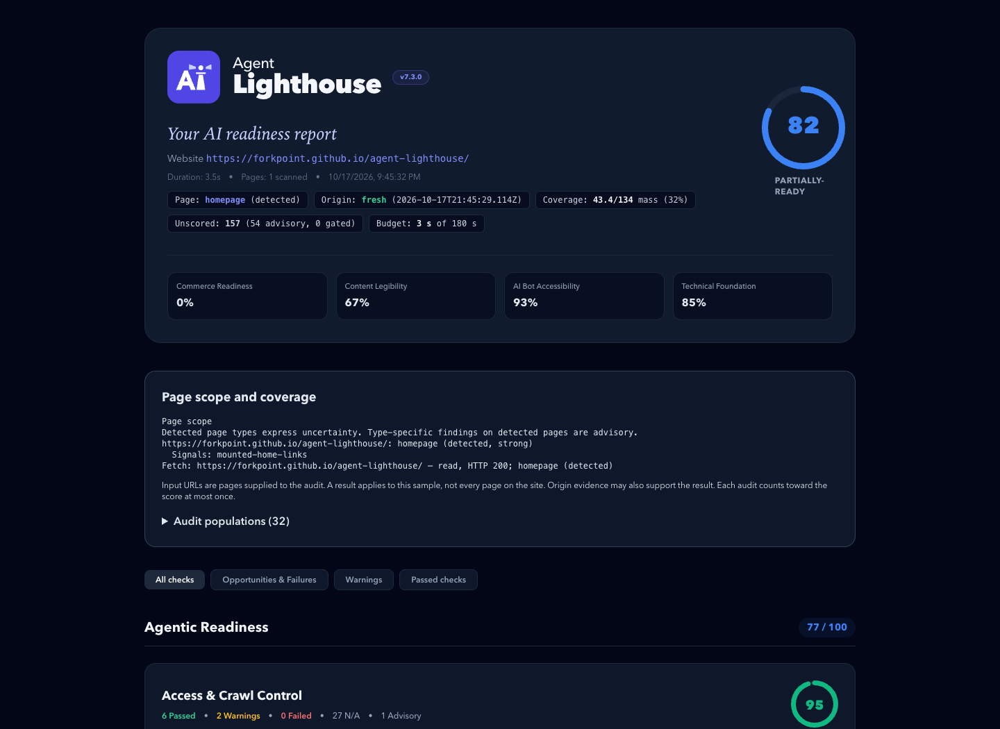

<div align="center">
  <h1>
    
  </h1>
  <p><strong>Lighthouse, but for AI agents.</strong></p>
  <p>Audit whether ChatGPT, Claude, Perplexity, MCP clients, AI crawlers, and agentic browsers can discover, parse, cite, and act on your website.</p>
  <p>
    <a href="https://www.npmjs.com/package/@forkpoint/agent-lighthouse"></a>
    <a href="https://www.npmjs.com/package/@forkpoint/agent-lighthouse"></a>
    <a href="https://github.com/ForkPoint/agent-lighthouse/actions/workflows/ci.yml"></a>
    <a href="https://forkpoint.github.io/agent-lighthouse/"></a>
    <a href="./LICENSE"></a>
  </p>
  <p>
    <a href="https://forkpoint.github.io/agent-lighthouse/">Documentation</a>
    ·
    <a href="https://www.npmjs.com/package/@forkpoint/agent-lighthouse">npm</a>
    ·
    <a href="https://github.com/ForkPoint/agent-lighthouse/issues/new?template=site-score.yml">Share a site score</a>
    ·
    <a href="https://forkpoint.github.io/agent-lighthouse/branding/">Brand kit</a>
  </p>
</div>



An example report. Its scores describe one past scan, not the site's current state.

---

## ⚡ Quickstart

Requires Node.js 22.22.2+ (22.x), 24.15.0+ (24.x), or 26+.

```bash
# Terminal report, plus HTML and JSON reports in ./reports
npx @forkpoint/agent-lighthouse https://example.com

# Open the HTML report in your browser
npx @forkpoint/agent-lighthouse https://example.com --view

# Fail (exit 1) below a score, for CI
npx @forkpoint/agent-lighthouse https://staging.example.com --min-score 85
```

<!-- registry:audits -->223<!-- /registry:audits --> audits cover `llms.txt`, robots.txt crawler policy, Schema.org, OpenAPI discovery, WebMCP action surfaces, AEO/GEO content structure, agentic commerce, and operability. Every flag is in the [CLI reference](docs/cli.md); config files and SDK options are in [configuration](docs/config.md); how the score is built is in [scoring](docs/scoring.md).

---

## Agentic readiness skill

The [`agent-lighthouse` skill](plugins/agent-lighthouse/skills/agent-lighthouse/SKILL.md) lets a coding agent turn a report into verified fixes, on any website stack. It traces findings through source files and hosting settings, and keeps local fixes apart from deployed scan results.

Install it from this repository's marketplace. In Claude Code:

```sh
claude plugin marketplace add ForkPoint/agent-lighthouse
claude plugin install agent-lighthouse@agent-lighthouse
```

In Codex:

```sh
codex plugin marketplace add ForkPoint/agent-lighthouse
codex plugin add agent-lighthouse@agent-lighthouse
```

From a local checkout, pass `/absolute/path/to/agent-lighthouse` to `marketplace add`. Start a new chat after installing. The CLI and MCP npm packages are separate. See the [installation and workflow guide](packages/website/src/content/readiness-skill.md).

---

## 🎯 What Agent Lighthouse Checks

Agent Lighthouse evaluates websites across **8 agent-journey categories** grouped into **3 readiness pillars**:

```
├── 1. Agentic Readiness
│   ├── Access & Crawl Control (robots.txt rules for GPTBot, ClaudeBot, PerplexityBot, blocks, status codes)
│   ├── Machine Discovery (llms.txt, llms-full.txt, sitemaps, feeds, .well-known surfaces)
│   ├── Agent Interfaces (WebMCP manifests, OpenAPI specs, agents.json, search actions)
│   └── Agentic Commerce (product offers, availability, checkout and payment surfaces)
│
├── 2. AI Search Optimization
│   ├── Content Extraction (clean main content, semantic structure, render and response cost)
│   ├── Structured Data (Schema.org Product, Offer, SKU, GTIN, Organization, JSON-LD validity)
│   └── Answer Readiness (direct answerability, step lists, tables, unique data, citations)
│
└── 3. Technical Foundation
    └── Agent Operability & Safety (HTTPS, security.txt, tdmrep, stability, broken agent endpoints)
```

---

## 📦 Packages & Architecture

A pnpm monorepo published under the **`@forkpoint`** scope:

| Package               | npm Package                                                                                              | Description                                                     |
| :-------------------- | :------------------------------------------------------------------------------------------------------- | :-------------------------------------------------------------- |
| **`packages/cli`**    | [`@forkpoint/agent-lighthouse`](https://www.npmjs.com/package/@forkpoint/agent-lighthouse)               | Main CLI binary (`npx @forkpoint/agent-lighthouse <url>`).      |
| **`packages/core`**   | [`@forkpoint/agent-lighthouse-core`](https://www.npmjs.com/package/@forkpoint/agent-lighthouse-core)     | Core gatherer-audit engine, scoring algorithms, and types.      |
| **`packages/report`** | [`@forkpoint/agent-lighthouse-report`](https://www.npmjs.com/package/@forkpoint/agent-lighthouse-report) | Standalone HTML, Markdown, and unified report view-model.       |
| **`packages/mcp`**    | [`@forkpoint/agent-lighthouse-mcp`](https://www.npmjs.com/package/@forkpoint/agent-lighthouse-mcp)       | Model Context Protocol (MCP) server for Claude / Cursor / IDEs. |

---

## 🛡️ GitHub Actions CI

```yaml
- uses: ForkPoint/agent-lighthouse@main
  with:
    url: https://staging.example.com
    min-score: "85"
    github-token: ${{ secrets.GITHUB_TOKEN }}
```

The action writes terminal, HTML, JSON, and Markdown reports. With `github-token` it comments the Markdown summary on the pull request. Inputs and pinning are in the [GitHub Action guide](docs/github-action.md).

---

## 💻 Programmatic Node.js / TypeScript SDK

```typescript
import { runScan } from "@forkpoint/agent-lighthouse-core";
import {
  buildReportView,
  generateHtmlReport,
} from "@forkpoint/agent-lighthouse-report";

const report = await runScan("https://example.com");
const view = buildReportView(report);

// overallScore is null when the scan saw too little to judge the site
console.log(`Overall Score: ${view.overallScore}/100 (${view.scoreTier})`);

const html = generateHtmlReport(report); // standalone HTML report
```

Options are in [programmatic options](docs/config.md#programmatic-options).

---

## 🤖 Model Context Protocol (MCP) Server

Let Claude Desktop, Cursor or another MCP client run scans through the `audit_website` tool:

```json
{
  "mcpServers": {
    "agent-lighthouse": {
      "command": "npx",
      "args": ["-y", "@forkpoint/agent-lighthouse-mcp"]
    }
  }
}
```

---

## 📣 Share Your Score

Reports are standalone files: attach them to pull requests, send them to clients, or publish a before/after. Put the score in a README with a [badge](docs/badge.md). Share a public site's result through the [site score template](https://github.com/ForkPoint/agent-lighthouse/issues/new?template=site-score.yml).

More: [media kit](docs/media-kit.md) (boilerplate, screenshots, logos) · [brand guide](packages/website/public/brand/BRAND.md) · [brand kit download](https://github.com/ForkPoint/agent-lighthouse/raw/refs/heads/main/packages/website/public/brand/agent-lighthouse-brand-kit.zip)

---

## 🛠️ Development

```bash
git clone https://github.com/ForkPoint/agent-lighthouse.git
cd agent-lighthouse
pnpm install
pnpm build
pnpm test   # deterministic tests with fixed inputs
```

Contributor rules, including how to add an audit, are in [CLAUDE.md](CLAUDE.md).

---

## 📄 License

Apache-2.0 © [ForkPoint](https://github.com/ForkPoint)
